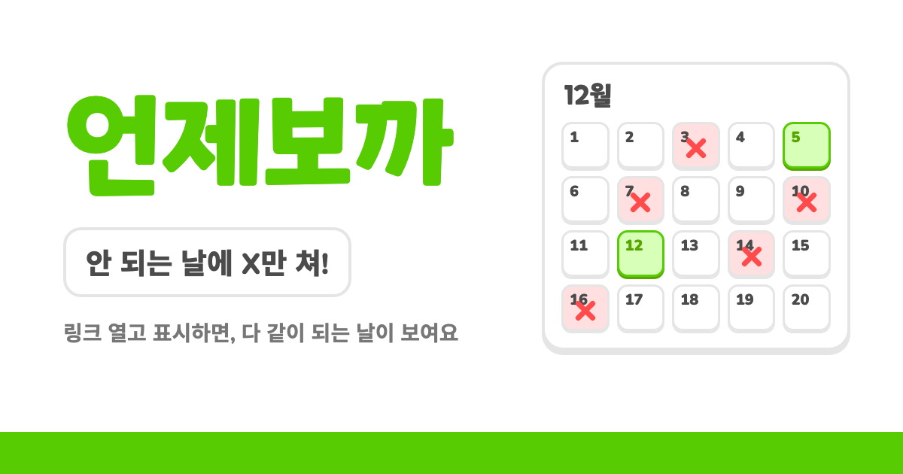
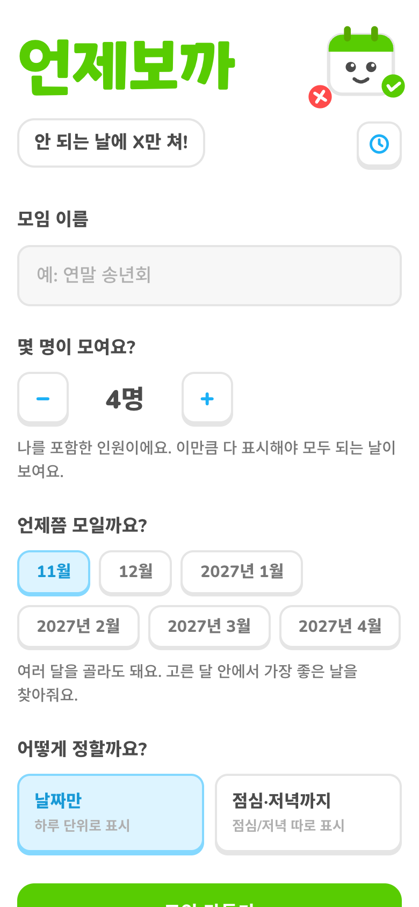
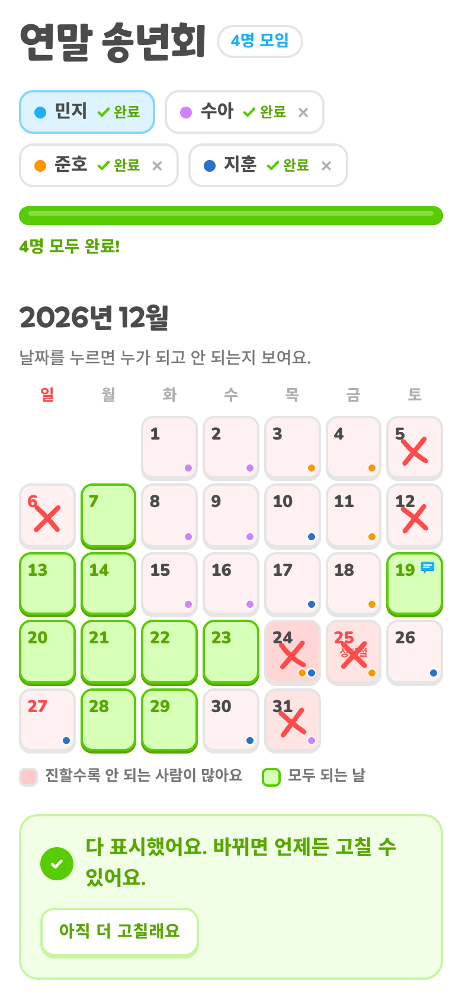
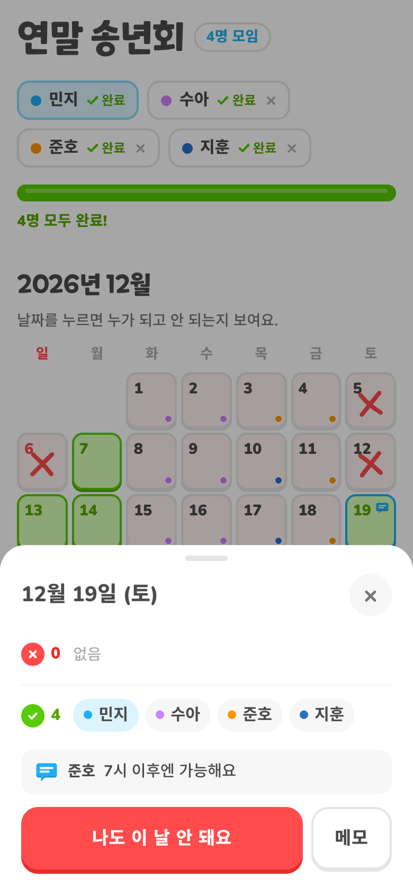
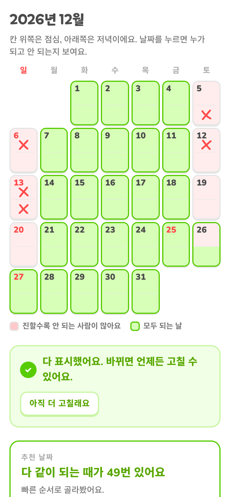

<div align="center">



# 언제보까

**친구들한테 링크 하나만 보내세요. 각자 안 되는 날에 X만 치면, 다 같이 되는 날이 보여요.**

[**👉 바로 써보기**](https://unzeboka.vercel.app)

<sub>회원가입 없이 · 앱 설치 없이 · 휴대폰에서 바로</sub>

</div>

<br>

<table>
  <tr>
    <td align="center"></td>
    <td align="center"></td>
    <td align="center"></td>
    <td align="center"></td>
  </tr>
  <tr>
    <td align="center"><sub>모임 만들기</sub></td>
    <td align="center"><sub>다 같이 되는 날은 초록</sub></td>
    <td align="center"><sub>누가 되고 안 되는지 + 메모</sub></td>
    <td align="center"><sub>점심·저녁 따로 정하기</sub></td>
  </tr>
</table>

<br>

## 이렇게 써요

1. **모임 만들기**: 모임 이름, 인원(2~10명), 모일 달을 고르고 만들어요.
2. **링크 보내기**: 단톡방에 링크를 보내요. 친구들은 별명만 적고 들어와요.
3. **안 되는 날에 X**: 날짜를 누르면 X, 쭉 그으면 여러 날에 한 번에 X를 쳐요.
4. **다 표시했어요**: 누르면 그때부터 모두의 결과가 보여요.
5. **날짜 고르기**: 정원이 다 표시하면 다 같이 되는 날이 초록으로 칠해지고, 추천 날짜 목록이 나와요.

## 이런 점이 좋아요

- 🎯 **다 안 돼도 최선의 날**  
  모두 되는 날이 없으면, 안 되는 사람이 가장 적은 날부터 골라서 추천해 줘요.
- 🍚 **점심·저녁 나눠 정하기**  
  날짜만 정할지, 점심과 저녁을 나눠 정할지 모임을 만들 때 골라요.
- 💬 **날짜마다 메모**  
  "7시 이후엔 가능해요"처럼 날짜마다 한 줄 메모를 남길 수 있어요.
- 👻 **30일 뒤 자동 정리**  
  모임은 만든 날부터 30일이 지나면 깔끔하게 사라져요.
- 🙋 **내 일정대로 솔직하게**  
  남의 표시에 맞추다 보면 진짜 되는 날을 놓쳐요. 그래서 내가 다 표시한 뒤에 모두의 결과를 보여줘요.
- 📊 **참여 현황을 한눈에**  
  몇 명이 들어왔고 몇 명이 표시를 끝냈는지 막대 그래프로 보여줘요.

<br>

---

<details>
<summary><b>🛠️ 개발자용: 직접 띄우기 · 설정 · 배포</b></summary>

<br>

### 구성

빌드 도구 없이 HTML, CSS, JavaScript만으로 만든 정적 사이트예요. 데이터는 Firebase Firestore에 실시간으로 저장해요.

| 파일 | 하는 일 |
|---|---|
| `index.html` | 화면 뼈대, 링크 미리보기(OG) 설정 |
| `style.css` | 디자인 (듀오링고 스타일) |
| `app.js` | 동작 전부: 달력, X 긋기, 실시간 공유, 추천, 메모, 최근 모임 |
| `holidays.js` | 공휴일 목록 (2026~2027년) |
| `firebase-config.js` | Firebase 연결 정보 |
| `firestore.rules` | Firestore 보안 규칙 |
| `scripts/cleanup.mjs` | 30일 지난 모임 정리 스크립트 |
| `.github/workflows/cleanup.yml` | 정리 스크립트를 매일 돌리는 GitHub Actions |

### 내 컴퓨터에서 띄우기

```bash
python3 -m http.server 5178
```

`http://localhost:5178`을 열어요. 파일을 더블클릭해서 열면 동작하지 않아요.

`firebase-config.js`의 `apiKey`가 `YOUR_`로 시작하면 **체험 모드**로 동작해요. 기록이 이 브라우저에만 저장되고, 같은 브라우저의 탭끼리 실시간으로 동기화돼요.

### Firebase 설정

1. [Firebase 콘솔](https://console.firebase.google.com)에서 프로젝트를 만들어요.
2. **Firestore Database** > 데이터베이스 만들기: Standard, 위치 `asia-northeast3 (서울)`, 데이터베이스 ID는 `(default)` 그대로
3. **규칙** 탭에 `firestore.rules` 내용을 붙여넣고 **게시**해요. 규칙 파일이 바뀌면 다시 게시해야 해요.
4. 프로젝트 설정 > **내 앱** > 웹 앱을 등록하고, 나오는 값을 `firebase-config.js`에 넣어요. `import` 줄은 빼고 `export const firebaseConfig = { ... }` 형식만 남겨요.
5. (권장) Google Cloud 콘솔 > API 및 서비스 > 사용자 인증 정보에서 Browser key를 배포 주소와 `localhost`에서만 쓰도록 제한해요.

> Firebase 웹 API 키는 공개돼도 괜찮은 값이에요. 데이터는 보안 규칙이 지켜요.

### 배포 (Vercel)

1. [Vercel](https://vercel.com) > **Add New > Project** > 이 저장소를 Import해요.
2. Framework Preset은 **Other**, 빌드 설정은 비워두고 **Deploy**해요.
3. 배포 주소를 `index.html`의 `og:image` 주소에 반영해요.
4. 카카오톡 미리보기가 안 바뀌면 [카카오 공유 디버거](https://developers.kakao.com/tool/debugger/sharing)에서 캐시를 지워요.

`README.md`, `firestore.rules`, `scripts/`, `.github/`, `docs/`는 `.vercelignore`로 배포에서 빠져요.

### 30일 지난 모임 정리 (GitHub Actions)

무료 요금제(Spark)에서는 Firestore TTL을 쓸 수 없어서, GitHub Actions가 매일 새벽 3시(한국 시간)에 만든 지 30일 지난 모임을 지워요.

1. Firebase 콘솔 > 프로젝트 설정 > **서비스 계정** > **새 비공개 키 생성**으로 JSON 키를 받아요.
2. GitHub 저장소 > Settings > Secrets and variables > Actions에 `FIREBASE_SERVICE_ACCOUNT` 이름으로 JSON 내용 전체를 넣어요.
3. 받은 키 파일은 컴퓨터에서 지워요. 절대 저장소에 올리지 않아요.
4. Actions 탭 > **지난 모임 정리** > Run workflow로 바로 돌릴 수 있어요. 기본은 미리보기(지우지 않음)예요.

저장소가 공개라 Actions 로그도 공개예요. 그래서 로그에는 모임 ID와 이름 없이 개수와 만든 날짜만 남겨요.

### 알아둘 점

- 로그인이 없어서, 링크를 아는 사람은 같은 별명으로 들어가 그 사람 기록을 고칠 수 있어요. 친한 친구들끼리 쓰는 걸 전제로 했어요.
- 방장 표시와 최근 모임 목록은 브라우저에 저장돼요. 다른 브라우저나 다른 앱(카톡, 네이버 앱)에서는 보이지 않아요.
- `holidays.js`는 매년 6월 말 다음 해 월력요항이 발표되면 추가해 주세요.

</details>

<br>

<div align="center"><sub>made by <a href="https://github.com/YerangPark">YerangPark</a></sub></div>
